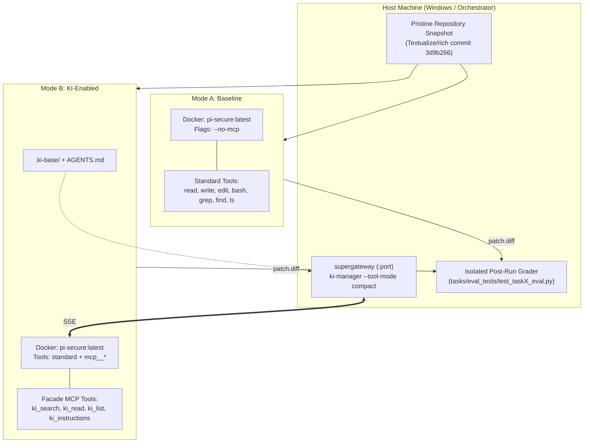

# 📊 KI-Manager Evaluation Benchmark

> **Empirical Evaluation of Structured Knowledge Bases (`ki-manager` MCP) for Autonomous AI Coding Agents**  
> *A reproducible, sandboxed A/B benchmark measuring accuracy, cost, time-to-first-edit, and architectural compliance across 9 LLMs on `Textualize/rich`.*

[](LICENSE)
[](https://www.python.org/downloads/)
[](https://modelcontextprotocol.io/)
[-orange.svg)](https://www.swebench.com/)

---

## 📌 Executive Summary

Modern AI coding agents frequently struggle with large, mature codebases. When presented with complex tasks, agents often spend **40–70% of their token budget and interaction steps on blind exploration** (`grep`, `find`, opening irrelevant files) and frequently violate unwritten architectural invariants.

This repository hosts the **end-to-end evaluation suite** for [**ki-manager**](https://github.com/Laeryid/KI-base) — an open-source MCP (Model Context Protocol) knowledge engine that maintains structured Knowledge Items (`.ki-base/knowledge/`), Architecture Decision Records (`.ki-base/adr/`), and provides high-speed BM25 search over code knowledge through a compact MCP facade.

### Core Evaluation Questions
1. **Mid-Tier Parity:** Can cost-effective mid-tier models (e.g., *Gemini 3.8 Flash*, *DeepSeek v4.1*, *Qwen 2.5 Coder*) achieve or surpass Tier 1 flagship accuracy (e.g., *GPT-5.6 Sol*, *Claude Sonnet 4*) when augmented with `ki-manager` — while reducing operational cost by **5–8×**?
2. **Exploration Efficiency:** Does structured knowledge reduce `Time-to-First-Edit` and eliminate wasteful "blind" file searches?
3. **Architectural Compliance:** Does explicit indexing of ADRs (Architecture Decision Records) prevent silent violations of codebase design patterns?

---

## 🔬 Benchmark Methodology & Architecture

The benchmark evaluates models in a strict, reproducible **A/B double-blind testing framework**:
- **Mode A (Baseline):** The agent operates in a pristine clone of `Textualize/rich` with standard shell and file editing tools (`bash`, `read`, `edit`, `write`, `grep`, `find`, `ls`). Neither `.ki-base/` nor `AGENTS.md` is present, and MCP connectivity is completely disabled (`--no-mcp`).
- **Mode B (KI-Enabled):** The repository is augmented with curated Knowledge Items (`.ki-base/knowledge/`), Architecture Decision Records (`.ki-base/decisions/`), and navigation guidelines (`AGENTS.md`). The agent connects to the `ki-manager` MCP facade exposing 7 high-level tools (`ki_search`, `ki_read`, `ki_list`, `ki_instructions`, `ki_tools`, `ki_call`, `ki_mutate`) served via SSE over `supergateway`.



### Execution Sandbox & Anti-Cheating Harness

1. **Docker Execution Sandbox (`pi-secure:latest`)**:
   - Runs on Debian Bookworm with Node.js 20, Python 3.11, and Pi 1.5.0 (`@mariozechner/pi-coding-agent`).
   - Unprivileged non-root user `agent` (UID 1000) with `--cap-drop ALL` and `--security-opt no-new-privileges`.
   - **Pre-installed Test Dependencies**: `pytest`, `pygments==2.13.0`, `markdown-it-py`, `attrs`, and `typing-extensions` are baked directly into the base image. This prevents agents from wasting turns and token budget executing package installations (`pip install`).
   - **Inter-turn Rate Limiting & Pacing**: Inter-step pacing is tuned to **0.5s** with backoff handling, preserving model connection stability and avoiding prompt cache evictions.

2. **Clean Prompt Dispatch Invariant**:
   - To eliminate command-line quotation corruption across the Windows PowerShell $\to$ WSL2 Docker boundary and avoid polluting prompt context with file attachment artifacts (`<file>`), the orchestrator writes the prompt to `$AgentDir/PROMPT.txt`.
   - Pi is invoked via an entrypoint script (`/pi-agent/launch_pi.sh`):
     ```bash
     #!/bin/bash
     exec pi -p "$(cat /pi-agent/PROMPT.txt)" "$@"
     ```

3. **Post-Run Anti-Cheating Invariant (ADR-0001)**:
   - Hidden evaluation tests (`tasks/eval_tests/`) and golden patches (`tasks/golden_patches/`) are **strictly prohibited** from existing inside the sandbox volume while the agent is executing.
   - The evaluated agent only sees standard repository unit tests (`rich/tests/`).
   - Once the agent exits and the git patch (`patch.diff`) is cleanly extracted (excluding `AGENTS.md` and `.ki-base/`), the evaluation test suite is injected, executed, and deleted immediately:
     - **`FAIL_TO_PASS`**: Verifies that the targeted bug or feature requirements are completely satisfied.
     - **`PASS_TO_PASS`**: Runs the existing test suite to ensure zero regressions across surrounding modules.
     - **AST & Architectural Verification**: Static AST checks verify architectural compliance (e.g., Task 3 enforces `__rich_console__` implementation and strictly forbids accessing `console._buffer`).

4. **Deterministic Billing & Telemetry**:
   - Exact per-step token telemetry (input tokens, cached read/write tokens, reasoning tokens, output tokens) and USD expenditures (`totalFromProvider`) are extracted directly from `pi_session.jsonl`.
   - Automated financial circuit breaker halts the matrix immediately if cumulative spend reaches **$80.00 USD**.

---

## 📐 Experimental Matrix (162 Runs)

The benchmark executes **162 independent evaluation runs**:
$$\text{9 Models} \times \text{3 Tasks} \times \text{2 Modes (Baseline / KI)} \times \text{3 Repetitions} = 162 \text{ runs}$$

### Model Roster & Reasoning Configurations (via OpenRouter)

| Tier | Model ID | Developer | Input / Output ($/1M) | Cache Read ($/1M) | Reasoning Mode | Thinking CLI Flag |
| :--- | :--- | :--- | :---: | :---: | :---: | :---: |
| **Tier 1: Flagship** | `openai/gpt-5.6-sol` | OpenAI | $4.00 / $20.00 | $0.40 | Native Reasoning | Automatic (provider) |
| **Tier 1: Flagship** | `anthropic/claude-sonnet-4.5` | Anthropic | $3.00 / $15.00 | $0.30 | Adaptive Thinking | `medium` |
| **Tier 1: Flagship** | `google/gemini-4-argon` | Google | $2.00 / $10.00 | $0.10 | Direct Execution | `--thinking off` |
| **Tier 2: Mid-tier** | `google/gemini-3.8-flash` | Google | $0.75 / $3.75 | $0.075 | Direct Execution | `--thinking off` |
| **Tier 2: Mid-tier** | `deepseek/deepseek-v4.1-flash` | DeepSeek | $0.27 / $1.10 | $0.07 | Direct Execution | Standard inference |
| **Tier 2: Mid-tier** | `qwen/qwen-2.5-coder-32b-instruct` | Alibaba | $0.15 / $0.60 | — | Direct Instruction | Standard inference |
| **Tier 3: Budget** | `anthropic/claude-haiku-5.5` | Anthropic | $0.80 / $4.00 | $0.08 | Adaptive Thinking | `medium` |
| **Tier 3: Budget** | `openai/gpt-5.6-luna` | OpenAI | $0.20 / $1.20 | $0.02 | Native Reasoning | Automatic (provider) |
| **Tier 3: Budget** | `google/gemini-2.5-flash` | Google | $0.15 / $0.60 | $0.015 | Direct Execution | `--thinking off` |

### Reasoning / Thinking Policy by Provider

Different model architectures handle multi-turn agentic reasoning differently. To ensure complete reproducibility and eliminate API transport failures, reasoning modes are configured as follows:

1. **Google Gemini Series (`--thinking off`)**:
   - **Models**: `google/gemini-2.5-flash`, `google/gemini-3.8-flash`, `google/gemini-4-argon`.
   - **Configuration**: Explicitly passed `--thinking off` in `benchmark_runner.ps1`.
   - **Technical Rationale**: OpenRouter proxies Gemini reasoning tokens in encrypted internal formats (`thought_tokens`). In multi-turn agent conversations, replaying previously encrypted reasoning tokens in subsequent turns triggers deserialization errors (`HTTP 400 Bad Request` or `500 Provider Error`) or breaks prefix prompt caching. Disabling thinking guarantees deterministic multi-turn tool calling and stable prompt cache utilization ($0.015/1M).

2. **Anthropic Claude Series (Adaptive Thinking: `medium`)**:
   - **Models**: `anthropic/claude-haiku-5.5`, `anthropic/claude-sonnet-4.5`.
   - **Configuration**: Uses Claude's native extended thinking protocol (`thinkingLevel: "medium"`).
   - **Technical Rationale**: Anthropic's Messages API natively supports prefix-cached reasoning tokens. Pi 1.5.0 records reasoning tokens in `pi_session.jsonl` (`usage.reasoning`), providing empirical data on whether `ki-manager` reduces internal reasoning deliberation during architectural exploration.

3. **OpenAI GPT-5.6 Series (Native Reasoning)**:
   - **Models**: `openai/gpt-5.6-luna`, `openai/gpt-5.6-sol`.
   - **Configuration**: Governed natively by the provider engine.
   - **Technical Rationale**: High-capacity reasoning runs directly prior to tool calls. Reasoning token consumption is automatically aggregated into the total token cost calculations.

4. **Specialized Open-Weights Coding Models (Direct Instruction)**:
   - **Models**: `qwen/qwen-2.5-coder-32b-instruct`, `deepseek/deepseek-v4.1-flash`.
   - **Configuration**: Standard instruction inference without separate chain-of-thought scratchpad blocks.
   - **Technical Rationale**: Evaluates pure instruction adherence, syntactical code accuracy, and direct reactive responsiveness to MCP tool calls.

---

## 🎯 The Three Benchmark Tasks

Tasks are designed against [`Textualize/rich`](https://github.com/Textualize/rich) (~35k lines of Python code, verified test suite):

1. **Task 1: Cross-Module Bugfix (SWE-bench Verified)**
   * **Domain:** `rich/table.py`, `rich/_ratio.py`, `rich/layout.py`.
   * **Issue:** `ZeroDivisionError` and line-wrapping corruption when calculating column ratios in collapsed nested tables.
   * **Target:** Rapid identification of cross-module dependencies without blind crawling.
2. **Task 2: Feature Extension (Design Pattern Extension)**
   * **Domain:** `rich/style.py`, `rich/default_styles.py`, `rich/_palettes.py`, `rich/terminal_theme.py`.
   * **Issue:** Implementation of the `double_underline` ANSI modifier (`\x1b[4:2m` / `\x1b[21m`) across parser, style composition arithmetic (`style1 + style2`), and HTML/SVG exporters.
   * **Target:** Completeness of changes across all architectural extension points.
3. **Task 3: ADR Compliance (Architectural Invariant)**
   * **Domain:** `rich/console.py`, `rich/segment.py`, new `rich/badge.py`.
   * **Invariant:** ADR-0002 mandates that visual components must implement `__rich_console__(self, console, options) -> RenderResult` yielding `Segment` iterators, with strict prohibition of `console._buffer` direct mutation.
   * **Target:** Adherence to established architectural constraints verified by AST and runtime checks.

---

## 📈 Measured Metrics

| Metric | Definition | Significance |
| :--- | :--- | :--- |
| **Pass@1 & Pass Rate** | Percentage of runs passing all hidden validation tests (`FAIL_TO_PASS`). | Core solution correctness. |
| **Regression-Free Rate** | Percentage of runs maintaining existing suite integrity (`PASS_TO_PASS`). | Safety against unintended breakage. |
| **Cost-per-Solved-Task ($)** | $\frac{\text{Total Cost of All Runs}}{\text{Number of Successful Runs}}$. | Real-world engineering ROI. |
| **Time-to-First-Edit** | Turns and tokens consumed before the agent's first code edit (`edit`/`write`). | Navigation and discovery speed. |
| **Exploration Waste** | Number of blind search actions (`grep`, `find`, unguided `read`) vs. directed calls (`ki_search`, `ki_read`). | Cognitive efficiency. |
| **ADR Compliance Rate** | Static (AST) and dynamic verification of architectural rules in Task 3. | Codebase architectural integrity. |

---

## 📁 Repository Layout

```
.
├── plan/                                 # Complete benchmark planning specifications
│   ├── 00_master_plan.md                 # Master blueprint and parameters
│   ├── phase_1_harness_and_docker.md     # Docker & harness environment upgrades
│   ├── phase_2_repo_and_tasks.md         # Target repository & 3 task specifications
│   ├── phase_3_ki_base_generation.md     # .ki-base knowledge indexing & ADRs
│   ├── phase_4_orchestrator_and_runner.md# Orchestrator & runner architecture
│   ├── phase_5_execution_matrix.md       # Staged rollout & budget guards
│   └── phase_6_evaluation_and_reporting.md# Metrics calculation & report generation
├── harness/                              # Test harness configuration
│   └── docker/                           # Dockerfile and pi-extensions definition
├── tasks/                                # Benchmark task assets
│   ├── prompts/                          # Isolated prompt files (task1, task2, task3)
│   ├── eval_tests/                       # Hidden evaluation test suites
│   └── golden_patches/                   # Verified reference solutions
├── orchestrator/                         # Benchmark automation scripts
│   ├── benchmark_runner.ps1              # Single-run execution pipeline
│   └── run_matrix.ps1                    # Staged matrix controller
├── analysis/                             # Telemetry parsing & statistics
│   ├── evaluate_results.py               # JSONL & pytest report aggregator
│   └── generate_charts.py                # Visual reporting & graphs
├── results/                              # (Generated) Raw session logs & reports
├── AGENTS.md                             # Operational instructions for AI coding agents
└── README.md                             # Main documentation (English)
```

---

## 🚀 Quickstart & Reproduction

### Prerequisites
1. **OS:** Windows 10/11 or Linux with Docker support.
2. **Docker Engine:** Configured and running.
3. **Node.js 20+ & npm:** For `supergateway` execution.
4. **Python 3.11+:** In a dedicated `.venv`.
5. **OpenRouter API Key:** Set in your environment:
   ```powershell
   $env:OPENROUTER_API_KEY = "sk-or-v1-..."
   ```

### 1. Build the Secure Agent Docker Image
```powershell
cd harness/docker
docker build -t pi-secure:latest .
```

### 2. Run Smoke Test (Stage 0)
Verify the end-to-end pipeline using the low-cost `gemini-2.5-flash` model (< $0.15):
```powershell
# Baseline run
.\orchestrator\benchmark_runner.ps1 -Model "google/gemini-2.5-flash" -Task "task1" -Mode "baseline" -Attempt 1

# KI-Enabled run
.\orchestrator\benchmark_runner.ps1 -Model "google/gemini-2.5-flash" -Task "task1" -Mode "ki" -Attempt 1
```

### 3. Run the Staged Matrix
```powershell
# Stage 1: Tier 3 Budget Models (~$4.00, 54 runs)
.\orchestrator\run_matrix.ps1 -Stage tier3

# Stage 2: Tier 2 Mid-tier Models (~$6.00, 54 runs)
.\orchestrator\run_matrix.ps1 -Stage tier2

# Stage 3: Tier 1 Flagship Models (~$32.00, 54 runs)
.\orchestrator\run_matrix.ps1 -Stage tier1

# Full Matrix (All 162 runs)
.\orchestrator\run_matrix.ps1 -Stage all
```

### 4. Aggregate Telemetry & Generate Final Report
```powershell
.venv\Scripts\python.exe analysis\evaluate_results.py --input-dir results/ --output-dir results/summary/
.venv\Scripts\python.exe analysis\generate_charts.py --input-csv results/summary/benchmark_summary.csv --output-dir results/summary/charts/
```

---

## 🔒 Security & Safety Guardrails
- **Hard Budget Cap:** The runner aborts automatically if cumulative expenditure reaches **$80.00 USD** (~74 €).
- **Execution Timeouts:** Strict 20-minute (1200s) timeout per run to prevent runaway agent loops.
- **Process Cleanup:** `supergateway` instances and Docker containers are forcibly reaped in deterministic `finally` blocks.

---

## 📜 Citation & Related Projects

* **`ki-manager` MCP Server:** [github.com/Laeryid/KI-base](https://github.com/Laeryid/KI-base) — Knowledge Items MCP server for AI coding agents.
* **SWE-bench:** [swebench.com](https://www.swebench.com/) — Software engineering benchmark for language models.
* **Model Context Protocol (MCP):** [modelcontextprotocol.io](https://modelcontextprotocol.io/) — Open protocol for agent-tool connectivity.

---

## 📄 License
This benchmark framework is released under the [MIT License](LICENSE).
