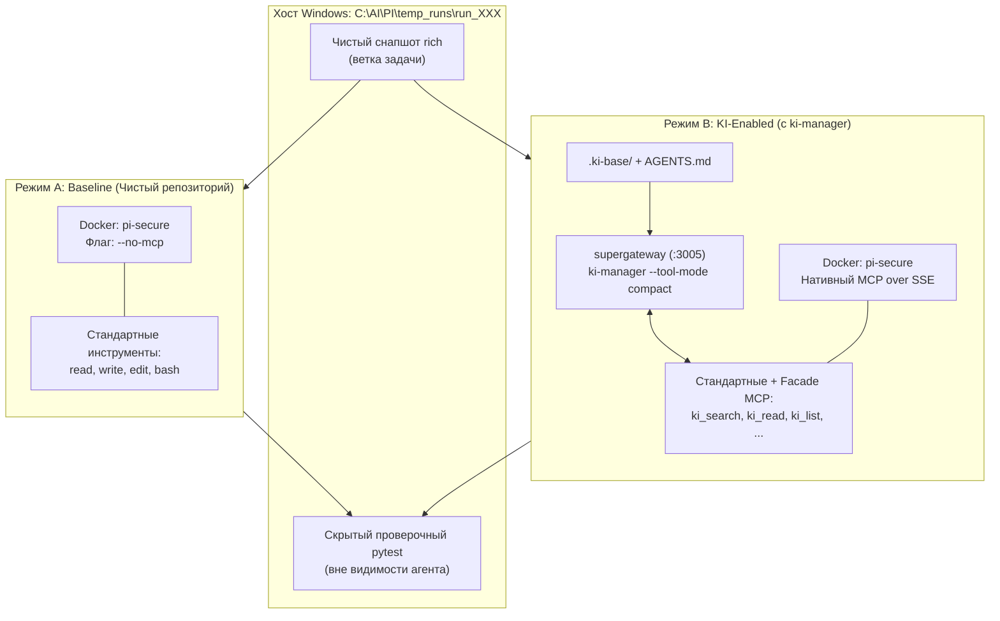

# Комплексный план бенчмарка эффективности `ki-manager`

> **Цель проекта:** Количественно и качественно измерить влияние базы знаний `ki-manager` на точность, скорость и стоимость решения реальных инженерных задач AI-агентами на зрелом Python-репозитории.

---

## 1. Базовые параметры эксперимента

| Параметр | Значение | Обоснование |
| :--- | :--- | :--- |
| **Целевой репозиторий** | [`Textualize/rich`](https://github.com/Textualize/rich) | Зрелый проект (~35k строк кода), участник золотого датасета **SWE-bench Verified**, сложная внутренняя архитектура при быстром автономном `pytest`. |
| **Тестовый стенд (Харнесс)** | `C:\AI\PI` (Docker `pi-secure` + Pi 1.0+) | Изоляция хоста (`--cap-drop ALL`, non-root), автоматический headless-запуск через CLI, встроенный детальный биллинг токенов в JSONL. |
| **MCP-транспорт** | `supergateway` (хост Windows) $\to$ нативный SSE (Docker) | `ki-manager` выполняется в боевом `.venv` на хосте, транслируя инструменты в изолированный контейнер без установки зависимостей в Docker. |
| **Провайдер API** | [OpenRouter](https://openrouter.ai/) | Единый API, отсутствие наценки на токены, прозрачный учёт Prompt Cache, поддержка всех ключевых моделей. |
| **Бюджетный лимит** | **100 €** (~$108) | Расчётная стоимость полной матрицы: **~$54–$58 (~50–54 €)** (запас прочности 45–50 €). |
| **Матрица запусков** | **162 прогона** | 9 моделей $\times$ 3 задачи $\times$ 2 режима (Baseline / KI) $\times$ 3 повтора (для нивелирования температурного шума). |

---

## 2. Архитектура режимов A/B тестирования

1. **Режим A (Baseline)**:
   - В репозитории отсутствуют папка `.ki-base/` и файл `AGENTS.md`.
   - Контейнер Pi запускается с флагом `--no-mcp`.
   - Агент опирается только на чтение исходников, `grep`/`find` через bash и свои базовые знания.
2. **Режим B (KI-Enabled)**:
   - В репозиторий скопированы предварительно размеченная папка `.ki-base/` и сгенерированный `AGENTS.md`.
   - `supergateway` поднимает `ki-manager` на хосте с флагом `--tool-mode compact` (7 фасадных инструментов).
   - Агент получает навигационные подсказки из `AGENTS.md` и фасадные инструменты `ki_search`, `ki_read`, `ki_list`, `ki_instructions`.

---

## 3. Матрица моделей (9 моделей OpenRouter, 2026)

| Класс | Модель (OpenRouter ID) | Провайдер | Input / Output ($ / 1M) | Cache Read ($ / 1M) | Стоимость 18 прогонов |
| :--- | :--- | :--- | :--- | :--- | :--- |
| **Tier 1: Флагманы** | `openai/gpt-5.6-sol` | OpenAI | $4.00 / $20.00 | $0.40 | **$12.60** |
| **Tier 1: Флагманы** | `anthropic/claude-sonnet-4` *(или 5.5)* | Anthropic | $3.00 / $15.00 | $0.30 | **$11.70** |
| **Tier 1: Флагманы** | `google/gemini-4-argon` | Google | $2.00 / $10.00 | $0.10 | **$8.10** |
| **Tier 2: Mid-tier** | `google/gemini-3.8-flash` | Google | $0.75 / $3.75 | $0.075 | **$3.60** |
| **Tier 2: Mid-tier** | `deepseek/deepseek-v4.1-flash` | DeepSeek | $0.27 / $1.10 | $0.07 | **$1.44** |
| **Tier 2: Mid-tier** | `qwen/qwen-2.5-coder-32b-instruct` | Alibaba | $0.15 / $0.60 | — | **$0.90** |
| **Tier 3: Бюджетные** | `anthropic/claude-haiku-5.5` *(или 3.5)* | Anthropic | $0.80 / $4.00 | $0.08 | **$2.70** |
| **Tier 3: Бюджетные** | `openai/gpt-5.6-luna` | OpenAI | $0.20 / $1.20 | $0.02 | **$0.72** |
| **Tier 3: Бюджетные** | `google/gemini-2.5-flash` | Google | $0.15 / $0.60 | $0.015 | **$0.54** |
| **ИТОГО за 162 прогона** | | | | | **$42.30 (~39 €)** |

*Сопутствующие расходы (разметка `.ki-base`, Smoke-тесты, комиссия 5.5%): **~$12–$15**.*  
*Итоговая смета: **~$54–$58 (~50–54 €)** при бюджете **100 €**.*

---

## 4. Ключевые метрики эффективности

1. **Качество решения (Success Rate)**:
   * `Pass@1` и `Pass Rate (3 attempts)`: прохождение целевых скрытых тестов (`FAIL_TO_PASS`).
   * `Regression-Free`: сохранение работоспособности существующего сьюта (`PASS_TO_PASS`).
   * `ADR Compliance`: следование архитектурному контракту в Задаче 3.
2. **Экономическая эффективность (Cost & Token Efficiency)**:
   * Общая стоимость решения задачи ($).
   * Суммарный объём входных, кэшированных и выходных токенов.
   * `Cost-to-Pass`: стоимость одного успешного решения.
3. **Эффективность навигации (Navigation Performance)**:
   * `Time-to-First-Edit`: количество шагов и токенов агента до первой осмысленной правки в коде.
   * `Total Turns`: общее количество шагов до завершения сессии.
   * `Exploration Waste`: количество вызовов `grep`/`find`/`read` «вслепую» в Baseline против направленных обращений через `ki_search`/`ki_read`.

---

## 5. Дорожная карта фаз и структура документов

План разбит на 6 детальных документов:

* [Фаза 1: Апгрейд тестового стенда Pi и Docker](file:///C:/Experiments/KI-base/plans/benchmark%20execution/phase_1_harness_and_docker.md)
* [Фаза 2: Репозиторий Textualize/rich и отбор 3 задач](file:///C:/Experiments/KI-base/plans/benchmark%20execution/phase_2_repo_and_tasks.md)
* [Фаза 3: Разметка базы знаний .ki-base и верификация](file:///C:/Experiments/KI-base/plans/benchmark%20execution/phase_3_ki_base_generation.md)
* [Фаза 4: Разработка скрипта-оркестратора бенчмарка](file:///C:/Experiments/KI-base/plans/benchmark%20execution/phase_4_orchestrator_and_runner.md)
* [Фаза 5: Пробный прогон (Smoke-test) и выполнение матрицы](file:///C:/Experiments/KI-base/plans/benchmark%20execution/phase_5_execution_matrix.md)
* [Фаза 6: Парсинг метрик, аналитика и финальный отчет](file:///C:/Experiments/KI-base/plans/benchmark%20execution/phase_6_evaluation_and_reporting.md)
