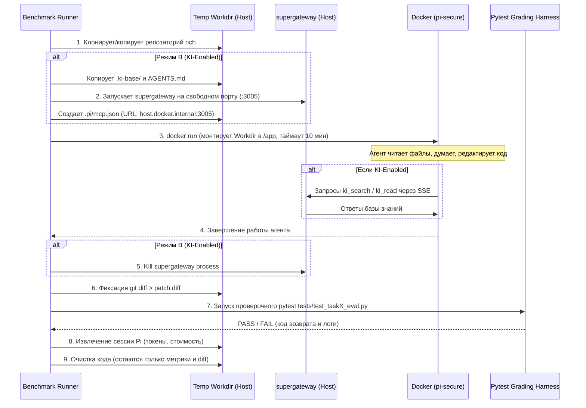

# Фаза 4: Разработка скрипта-оркестратора бенчмарка (`benchmark_runner`)

> **Цель фазы:** Создать надёжный, отказоустойчивый и полностью автономный скрипт-оркестратор (на PowerShell или Python), способный управлять сотнями изолированных запусков, жизненным циклом `supergateway`, таймаутами Docker и сбором телеметрии.

---

## 1. Задачи фазы

1. **Разработка движка изоляции запусков (Sandbox Manager)**:
   - Создание уникальной изолированной рабочей папки на хосте:
     `C:\Experiments\KI-manager evaluation\temp_runs\run_{model}_{task}_{mode}_{attempt}\`
   - Копирование исходного состояния репозитория без мусора из предыдущих сессий.
2. **Управление жизненным циклом MCP (`supergateway`)**:
   - Автоматический выбор свободного TCP-порта хоста.
   - Запуск `supergateway` в скрытом режиме с явным указанием `--workspace` и `--tool-mode compact`.
   - Гарантированное завершение процесса (`Stop-Process -Force`) в блоке `finally`.
3. **Управление Docker-контейнером** (изучить, нужно ли это делать отдельно для нашего PI-in-docker харнесса):
   - Запуск `docker run --rm` с флагами безопасности (`--cap-drop ALL`, `--security-opt no-new-privileges`).
   - Жёсткий таймаут выполнения (например, 20 минут на прогон) для предотвращения зависания агента.
4. **Оценка и сбор артефактов (Telemetry & Grading)**:
   - Извлечение полного `git diff` изменений агента.
   - Запуск проверочного `pytest` с изолированными тестами `eval_tests/`.
   - Парсинг JSONL-логов Pi для извлечения расхода токенов и стоимости.
   - Ротация и архивация: удаление тяжелых копий исходников с сохранением только легких артефактов (`patch.diff`, `pi_session.jsonl`, `grade.json`).

---

## 2. Жизненный цикл одного запуска (Run Lifecycle)



---

## 3. Спецификация скрипта `benchmark_runner.ps1`

### Поддерживаемые параметры:
```powershell
param(
    [string]$Model = "google/gemini-2.5-flash",
    [ValidateSet("task1", "task2", "task3")]
    [string]$Task = "task1",
    [ValidateSet("baseline", "ki")]
    [string]$Mode = "baseline",
    [int]$Attempt = 1,
    [int]$TimeoutSeconds = 600,
    [switch]$DryRun
)
```

### Логика блока выполнения:
```powershell
$RunId = "$($Task)_$($Mode)_$($Model -replace '[^a-zA-Z0-9]','_')_att$Attempt"
$RunDir = "C:\AI\PI\temp_runs\$RunId"
$ArtifactsDir = "C:\AI\PI\benchmark_results\$RunId"

try {
    # 1. Подготовка папки запуска
    New-Item -ItemType Directory -Path $RunDir -Force | Out-Null
    Copy-Item -Path "C:\Experiments\benchmark_rich\*" -Destination $RunDir -Recurse

    $McpArgs = "--no-mcp"
    $sgProcess = $null

    if ($Mode -eq "ki") {
        # Копируем .ki-base и AGENTS.md
        Copy-Item -Path "C:\Experiments\benchmark_rich_ki\.ki-base" -Destination "$RunDir\.ki-base" -Recurse
        Copy-Item -Path "C:\Experiments\benchmark_rich_ki\AGENTS.md" -Destination "$RunDir\AGENTS.md"

        # Запускаем supergateway на свободном порту
        $Port = Get-FreePort 3005
        $Stdio = "C:\Experiments\KI-base\.venv\Scripts\python.exe -m ki_manager.server --workspace `"$RunDir`" --tool-mode compact"
        $sgProcess = Start-Process "npx.cmd" -ArgumentList "supergateway", "--stdio", "`"$Stdio`"", "--port", "$Port" -WindowStyle Hidden -PassThru

        # Конфигурируем .pi/mcp.json
        $piDir = "$RunDir\.pi"
        if (-not (Test-Path $piDir)) { New-Item -ItemType Directory -Path $piDir | Out-Null }
        @{ mcpServers = @{ "ki-manager" = @{ url = "http://host.docker.internal:$Port/sse" } } } | ConvertTo-Json | Set-Content "$piDir\mcp.json"

        $McpArgs = "" # Нативный MCP активируется автоматически
    }

    # 2. Чтение промпта задачи
    $Prompt = Get-Content "C:\AI\PI\benchmark_harness\prompts\$Task.txt" -Raw

    # 3. Запуск агента в Docker
    $dockerCmd = "docker run --rm --name `"pi-$RunId`" --add-host `"host.docker.internal:host-gateway`" -v `"${RunDir}:/app:rw`" -e `"OPENROUTER_API_KEY=$env:OPENROUTER_API_KEY`" --cap-drop ALL --security-opt no-new-privileges pi-secure -p `"$Prompt`" --provider openrouter --model `"$Model`" --mode json $McpArgs"
    
    Invoke-WithTimeout -Command $dockerCmd -TimeoutSec $TimeoutSeconds

    # 4. Сохранение git diff
    Set-Location $RunDir
    git diff > "$ArtifactsDir\patch.diff"

    # 5. Прогон скрытого проверочного теста
    Copy-Item "C:\AI\PI\benchmark_harness\eval_tests\test_${Task}_eval.py" "$RunDir\tests\"
    $testResult = & pytest "tests\test_${Task}_eval.py" --json-report --json-report-file="$ArtifactsDir\pytest_report.json"
    
} finally {
    # 6. Гарантированная остановка supergateway
    if ($sgProcess -and -not $sgProcess.HasExited) {
        Stop-Process -Id $sgProcess.Id -Force -ErrorAction SilentlyContinue
    }
    # Очистка рабочей папки репозитория
    Remove-Item -Path $RunDir -Recurse -Force -ErrorAction SilentlyContinue
}
```

---

## 4. Чек-лист готовности Фазы 4
- [ ] Написан скрипт `benchmark_runner.ps1`.
- [ ] Реализована функция безопасного таймаута процессов.
- [ ] Проверена корректность старта и остановки `supergateway` в цикле (отсутствие зомби-процессов и утечек портов).
- [ ] Проверена изоляция: изменения одного запуска не влияют на последующие.
- [ ] Все артефакты (`patch.diff`, сессии, `pytest_report.json`) сохраняются в централизованное хранилище результатов.
