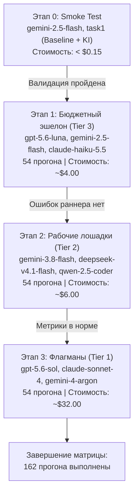

# Фаза 5: Пробный прогон (Smoke-test) и выполнение матрицы бенчмарка

> **Цель фазы:** Провести верификацию сквозного пайплайна на дешёвой модели, после чего поэтапно выполнить полную матрицу из 162 запусков с защитой от сбоев API, контролем бюджета и автоповторами.

---

## 1. Задачи фазы

1. **Проведение Smoke-test (сквозной валидации)**:
   - 1 задача (`task1`), 1 ультрадешёвая модель (`google/gemini-2.5-flash`), 2 режима (Baseline vs KI).
   - Суммарная стоимость теста: **<$0.15**.
   - Проверка: корректность генерации диффа, вызов `supergateway`, прогон проверочного `pytest`, корректность JSONL-парсинга.
2. **Поэтапное выполнение матрицы (Staged Rollout)**:
   - Запуск матриц не сразу на дорогих моделях, а по весовым категориям снизу вверх (Tier 3 $\to$ Tier 2 $\to$ Tier 1).
   - Это гарантирует, что любые неожиданные ошибки скрипта раннера будут выявлены на моделях со стоимостью $0.03 за прогон, а не $0.70.
3. **Обработка сбоев и сетевая устойчивость**:
   - Автоматический Retry при ошибках OpenRouter (429 Rate Limit, 502/503 Gateway Error) с экспоненциальной задержкой.
   - Защита от зависаний: принудительное завершение прогона при превышении 10 минут.
4. **Финансовый предохранитель (Budget Guard)**:
   - Автоматический мониторинг суммарных затрат в ходе прогона. Аварийный стоп при достижении порога в **$80 (~74 €)**.

---

## 2. Поэтапный план запусков (Execution Stages)



---

## 3. Детализация этапов

### Этап 0: Smoke-Test (10 минут)
* **Цель:** Убедиться, что `supergateway` поднимается и завершается, `pi` передаёт правильный JSONL, `pytest` ставит корректную оценку, а файлы очищаются.
* **Команды:**
  ```powershell
  .\benchmark_runner.ps1 -Model "google/gemini-2.5-flash" -Task "task1" -Mode "baseline" -Attempt 1
  .\benchmark_runner.ps1 -Model "google/gemini-2.5-flash" -Task "task1" -Mode "ki" -Attempt 1
  ```
* **Критерий успеха:** В `benchmark_results/` появились 2 валидные папки с артефактами (`patch.diff`, `grade.json`, `pi_session.jsonl`).

### Этап 1: Tier 3 — Бюджетные модели (54 прогона, ~2 часа)
* Модели: `openai/gpt-5.6-luna`, `google/gemini-2.5-flash`, `anthropic/claude-haiku-5.5`.
* Проверяется поведение легких моделей: насколько `ki-manager` компенсирует меньший размер параметров.

### Этап 2: Tier 2 — Рабочие лошадки (54 прогона, ~2.5 часа)
* Модели: `google/gemini-3.8-flash`, `deepseek/deepseek-v4.1-flash`, `qwen/qwen-2.5-coder-32b-instruct`.
* Проверяется эффективность на моделях со специализированным кодовым тюнингом.

### Этап 3: Tier 1 — Флагманские модели (54 прогона, ~3 часа)
* Модели: `openai/gpt-5.6-sol`, `anthropic/claude-sonnet-4`, `google/gemini-4-argon`.
* Проверяется предел возможностей: ускоряет ли `ki-manager` флагманы и экономит ли дорогие токены за счёт сокращения числа шагов (`Time-to-First-Edit`).

---

## 4. Стратегия повторов и обработка краевых случаев

| Ситуация | Реакция оркестратора |
| :--- | :--- |
| **HTTP 429 (Rate Limit)** | Пауза на 30 секунд $\to$ повтор запроса (до 3 попыток). |
| **HTTP 500 / 502 / 503** | Экспоненциальный бэкофф (5с, 15с, 45с) $\to$ повтор запуска. |
| **Превышение 10 минут** | Аварийный `docker rm -f`, статус `TIMEOUT`, запись нулевого Pass Rate. |
| **Сбой `supergateway`** | Перезапуск на новом случайно выбранном порту. |
| **Превышение бюджета ($80)** | Немедленный останов выполнения с сохранением уже собранных результатов. |

---

## 5. Чек-лист готовности Фазы 5
- [ ] Успешно пройден Этап 0 (Smoke-test) в обоих режимах.
- [ ] Проверены квоты и баланс OpenRouter ($100 пополнены).
- [ ] Этап 1 (Tier 3) завершён без критических сбоев оркестратора.
- [ ] Этап 2 (Tier 2) завершён.
- [ ] Этап 3 (Tier 1) завершён.
- [ ] Все 162 результата сохранены в директории `benchmark_results/`.
